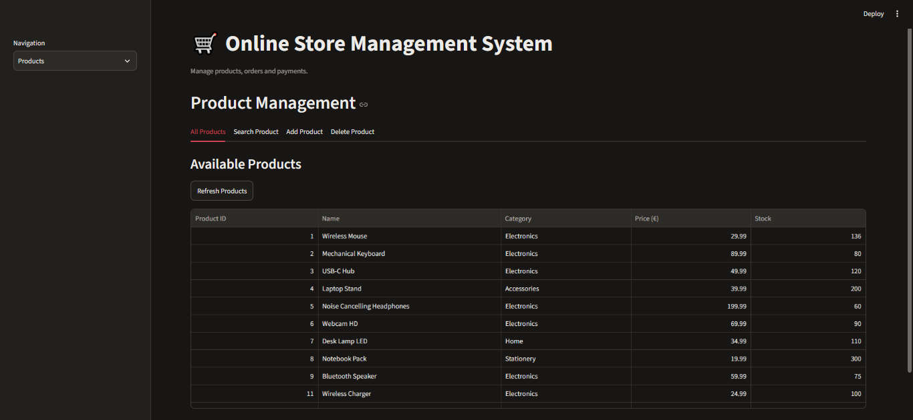
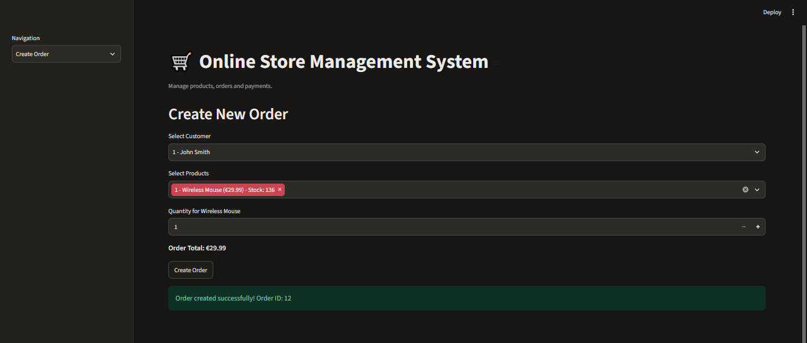
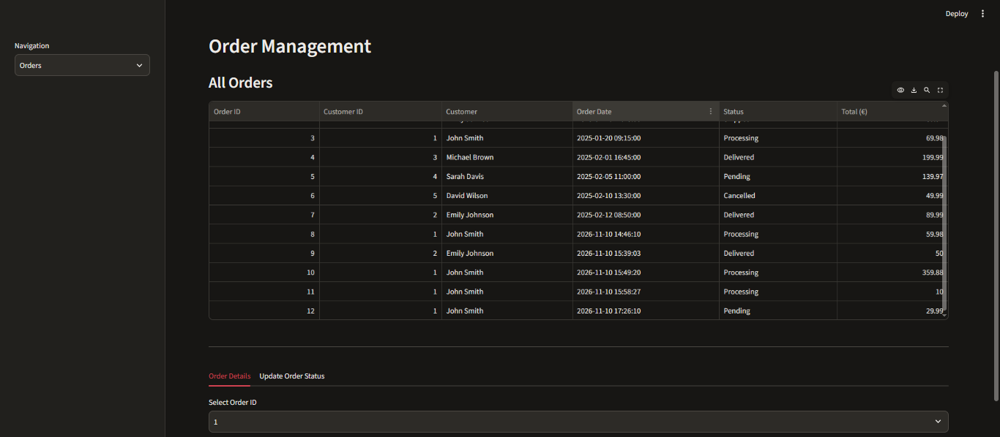
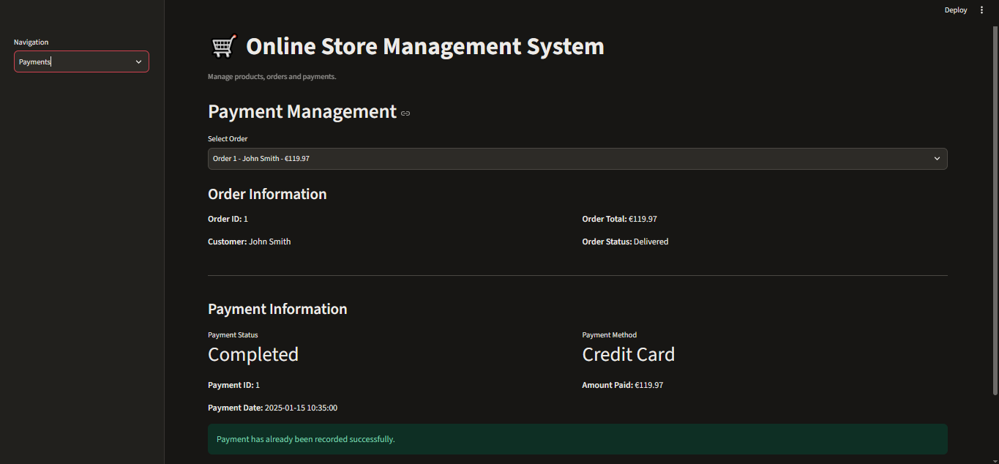
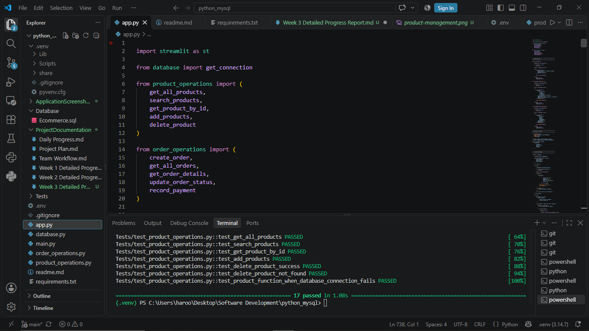

# Software Development – Week 3 Progress Report

**Group Members:**
1. Haroon Afridi
2. Pradeep Sapkota
3. Poshan Oli
4. Lamyae Echaoui

**Week:** Week 3  
**Topic:** Python and MySQL Database Operations

---

## 1. Introduction

During Week 3, our group continued developing the Online Store Management System using Python and MySQL. The main focus was connecting Python with the MySQL database, implementing database operations, and developing the application interface.

## 2. Work Completed

The following work was completed during this period:

- Connected the Python application to the MySQL database.
- Implemented product operations, including viewing, searching, adding, and deleting products.
- Developed order management functions for creating orders and viewing order details.
- Added functionality to update order statuses.
- Implemented payment recording and payment information display.
- Connected the backend functions with the Streamlit application.
- Improved the application interface to make it easier to use.
- Tested the main application functions and checked database operations.

## 3. Team Members' Contributions

### Haroon Afridi
Completed the  application development work. Main contributions included:

- Developing the Streamlit application interface.
- Connecting the application with the Python backend and MySQL database.
- Implementing and integrating product, order, and payment features.
- Improving the application workflow and handling different operations.
- Testing the application and fixing issues.

### Pradeep Sapkota
Pradeep contributed to the development of the Online Store Management System, mainly working on the application interface and supporting its development. He helped implement and improve some application features alongside Haroon. He also participated in discussions about the application workflow and functionality. His work supported the integration of the different parts of the system.

### Poshan Oli
Provided support mainly related to the order management part of the project and discussions about its functionality.

### Lamyae Echaoui
Provided support with reviewing the application and checking whether its main features worked correctly. Supporting the preparation and organization of project documentation. Reviewing the project progress and discussing possible improvements with the team.

## 4. Application Progress

The Online Store Management System now has a working Streamlit interface connected to the MySQL database.

The application supports:

- Product management
- Creating customer orders
- Viewing order details
- Updating order status
- Recording payments
- Viewing payment status and payment method

The application also automatically changes an order from **Pending** to **Processing** after a successful payment.

## 5. Application Screenshots

### Figure 1 – Product Management

This screenshot shows the product list, including product names, prices, categories and available stock.

### Figure 2 – Create Order

This screenshot shows the order creation page where customers and products can be selected.

### Figure 3 – Order Management

This screenshot shows the order list and order status management.

### Figure 4 – Payment Management

This screenshot shows payment information, including payment method, amount and payment status.

## 6. Testing

The application functions were tested during development. Automated tests were also added using pytest.

A total of **17 automated tests passed**, covering product operations, order creation, stock checking, order status updates, and payment handling. The tests use mocked database connections to avoid changing real database records.

### Figure 5 – Automated Testing Results

The project was tested using pytest. All 17 automated tests passed successfully.

## 7. Conclusion

During Week 3, we made good progress on the Online Store Management System. We developed the main application features using Python, MySQL, and Streamlit. The system now supports product management, order creation, order tracking, and payment recording. We also improved the application by displaying payment details and automatically changing an order's status from Pending to Processing after successful payment.

In addition, we created automated tests using pytest to check the main product, order, and payment functions. All 17 automated tests passed successfully. We also improved the project documentation and uploaded the latest changes to GitHub. Overall, this week's work helped us build a more functional and organized application. In the next stage, we plan to continue improving the system, review the code, and work on the remaining project requirements.
